  <picture>
    <source media="(prefers-color-scheme: dark)" srcset="./dark.svg">
    <source media="(prefers-color-scheme: light)" srcset="./light.svg">
    
  </picture>

<h3 align="center">Full Stack Web Developer | CS Undergrad | Aspiring AI Engineer</h3>

---

### 🧑‍💻 About Me

- 🎓 Pursuing a **Bachelor's in Computer Science (BSCS)**
- 💻 Passionate about **Web Development**, building fast, functional, and user-friendly applications
- 🐍 Comfortable across the stack — **JavaScript, Python, Firebase**, and modern web tools
- 🤖 Deeply interested in **AI, Machine Learning**, and where software meets intelligence
- 🌱 Constantly learning, refining my craft, and chasing the next hard problem worth solving
- 🌍 Believer in **Open Source** — building in public and learning out loud
- 🎯 **Goal:** Grow into a skilled **Software Engineer & AI Developer**

---

### ⚙️ Tech Stack

  

---

### 🚀 Featured Projects

| Project | What it does | Tech |
|---|---|---|
| **Fee Manager** (The Huzaifa Academy) | Admin dashboard for student records, fee collection, vouchers and reports | HTML, CSS, JavaScript |
| **Air Canvas** | Draw on screen with webcam hand gestures — index finger to draw, fingertip pinch to erase | Python, OpenCV, MediaPipe |
| **AI Chat Bot** *(in progress)* | Flask chat interface — UI and message flow work, live AI model not connected yet | Python, Flask, JavaScript |
| **Win32 Calculator** | Native Windows desktop calculator using raw WinAPI | C++ |

Plus a set of small JS apps: Todo, Expense Tracker, Quiz, Scientific Calculator, Digital Clock, Tic Tac Toe and more.

---

### 📊 GitHub Stats

  
  

  

---

### 🤝 Let's Collaborate

I'm always excited to work on projects involving **web apps, automation, or AI-powered tools**. If you're building something impactful — or just want to talk code — my inbox is open.

  <!-- TODO: apni real LinkedIn profile URL aur email yahan daalo -->
  
  

---

  <i>"Code is the closest thing we have to magic — write it with purpose."</i> ✨

  

